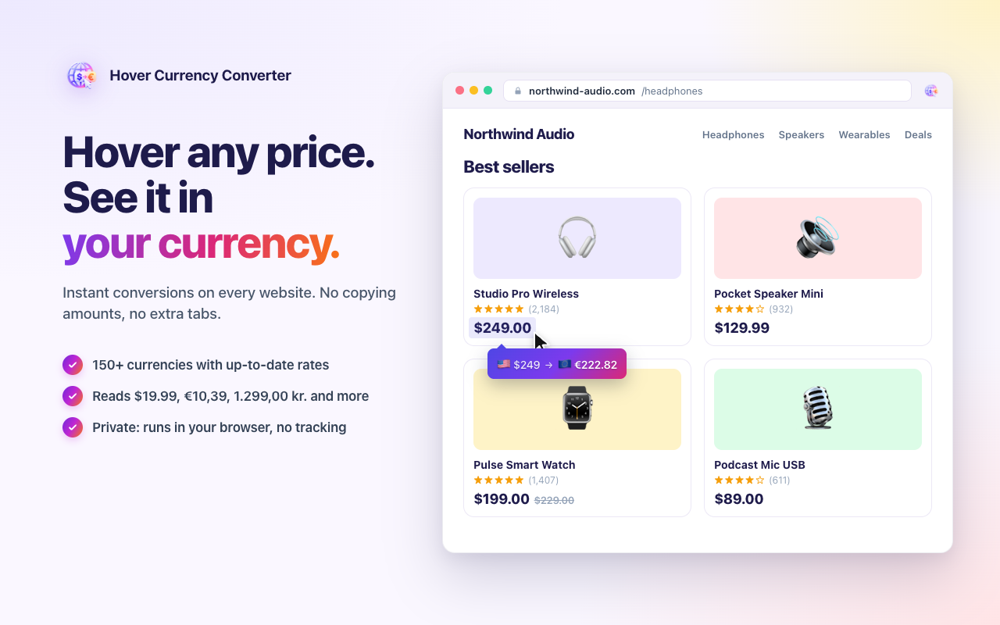

# Hover Currency Converter

<div align="center">
  
</div>

[](https://chromewebstore.google.com/detail/hover-currency-converter/plbdgcecigogedfihfmabohdbbbokfka)
[](https://chromewebstore.google.com/detail/hover-currency-converter/plbdgcecigogedfihfmabohdbbbokfka)

<div align="center">
  
</div>

Convert currency prices on hover - see converted values instantly when hovering over prices on any website.

## 🌟 Features

- **Instant Hover-to-Convert Tooltip** - Hover over prices like `$19.99`, `R$ 19,99`, `€49`, or `19.99 USD` to see instant conversions
- **Works on Any Website** - Automatically detects prices in various formats across all websites
- **Smart Shared-Symbol Detection** - Works out whether `kr`, `$`, `¥`, `£` and other shared symbols mean your currency or a foreign one, using the page's product data, language, URL and domain
- **Per-Site and Symbol Overrides** - Tell the extension which currency a site uses, or what a shared symbol should mean by default
- **Customizable Target Currency** - Choose your preferred currency in the side panel
- **Type-to-Search Currency Picker** - Quickly find your target and Quick Convert currencies by code or name without long scrolling
- **Quick Converter** - Use the side panel for manual currency conversions
- **Smart Caching** - Exchange rates are cached to minimize network usage
- **Easy Toggle** - Enable or disable the extension with one click
- **Clean Design** - Non-intrusive tooltip design that doesn't interfere with browsing
- **Privacy-First** - No personal data collection, all processing happens locally

## 📦 Installation

Install from the Chrome Web Store:

**[Install Hover Currency Converter](https://chromewebstore.google.com/detail/hover-currency-converter/plbdgcecigogedfihfmabohdbbbokfka)**

## 🚀 How to Use

1. **Install the extension** from the Chrome Web Store
2. **Open the side panel** by clicking the extension icon
3. **Select your target currency** from the dropdown menu
4. **Browse any website** and hover over prices
5. **See instant conversions** in a tooltip

### Example Usage

- Hover over `$19.99` → See conversion to your selected currency (e.g., `€18.50`)
- Hover over `R$ 19,99` → See conversion using local symbol-aware detection
- Hover over `€49` → See conversion to your selected currency (e.g., `$53.20`)
- Hover over `19.99 USD` → See conversion to your selected currency
- Hover over `1.299,00 kr.` on a Danish site → Detected as Danish kroner, not Swedish kronor

### Shared currency symbols

Some symbols are used by several currencies (`kr` by DKK, SEK, NOK and ISK; `$` by USD, CAD, AUD and more). The extension picks the currency using, in order:

1. Your override for the current site (side panel → **Currency Detection**)
2. Currency attributes on the price element (`data-currency`, microdata)
3. The page's product data (`priceCurrency`), URL currency/locale, locale subdomain, country domain, and page language
4. Your default for that symbol (side panel → **Shared symbol defaults**)
5. Your own currency, for symbols such as `kr` and `¥` (not `$` or `£`, which default to USD and GBP)

## 🛠️ Technical Details

- **Manifest Version:** 3
- **Permissions:**
  - `storage` - Store user settings and cached exchange rates
  - `sidePanel` - Display the settings panel
  - `activeTab` - Access page content for currency detection
  - `scripting` - Inject content scripts for price detection

- **API:** Uses public currency exchange rate APIs:
  - `https://cdn.jsdelivr.net/npm/@fawazahmed0/currency-api@*/*`
  - `https://*.currency-api.pages.dev/*`

- **Processing:** All currency detection and conversion happens locally in your browser for privacy and speed.

## 🔒 Privacy & Security

- ✅ **No personal data collection**
- ✅ **No tracking or analytics**
- ✅ **Currency detection happens locally**
- ✅ **Exchange rates fetched from public APIs only**
- ✅ **Settings stored locally on your device**

For more details, see [PRIVACY_POLICY.md](./PRIVACY_POLICY.md)

## 📁 Project Structure

```
Hover-Currency-Converter/
├── background/
│   └── service-worker.js    # Background service worker
├── content/
│   ├── content.js           # Content script for price detection
│   └── content.css          # Styles for tooltip
├── sidepanel/
│   ├── sidepanel.html       # Side panel UI
│   ├── sidepanel.js         # Side panel logic
│   └── sidepanel.css        # Side panel styles
├── icons/                   # Extension icons
├── screenshots/             # Screenshots and banners
├── manifest.json            # Extension manifest
└── README.md               # This file
```

## Development and testing

No build step or runtime dependencies are required. Load this directory with **Load unpacked** at `chrome://extensions` in Chrome or Ego, then reload the extension after edits.

Run the dependency-free regression suite with Node.js 22.7 or newer:

```sh
node --test tests/*.test.mjs
```

Serve the browser price fixtures locally:

```sh
python3 -m http.server 8765 --bind 127.0.0.1 --directory tests
```

Open `http://127.0.0.1:8765/e2e-prices.html` and `http://127.0.0.1:8765/e2e-shared-symbols.html` with the extension enabled. Check currency formats, keyboard focus/Enter/Escape, target changes, global/site toggles, and saved preferences. Automated tests cover parsing, shared settings, delayed UI replies, conversion validation, caching, API fallback, and offline/storage failures; mocked Chrome/DOM tests do not replace browser testing.

### Architecture

- `background/service-worker.js` owns exchange-rate fetching, caching, and conversion message handling. Its fallback injection reads the content script list from the manifest.
- `content/content.js` owns page interaction: price lookup, conversion requests, and listener lifecycle. `content/overlay.js` owns tooltip and highlight rendering on separate compositor layers; it never modifies page elements.
- `sidepanel/sidepanel.js` owns settings controls and quick conversion. `sidepanel/currency-picker.js` is the shared searchable currency dropdown used by both Target Currency and Quick Convert.
- `lib/settings-core.js` is the single source for settings defaults, normalization, and site matching. Classic content scripts load it directly; `lib/settings.js` exposes the same implementation to ES modules. The manifest is the single source for content script load order.
- `lib/currencies.js` is the shared currency catalog (symbols, flags, unambiguous symbol mappings). `lib/currency-parser.js` parses price text independently of Chrome and the DOM; `lib/currency-detection.js` resolves shared symbols from site overrides and page clues; `lib/network.js` handles bounded requests and retries.

See [ARCHITECTURE_REVIEW.md](./ARCHITECTURE_REVIEW.md) for remaining tradeoffs and follow-up priorities.

## 🎯 Perfect For

- Shopping on international websites
- Comparing prices across different currencies
- Understanding prices while browsing
- Quick currency conversions without leaving the page

## 🤝 Contributing

Contributions are welcome! Please feel free to submit a Pull Request.

## 📝 License

This project is open source and available for use.

## 📧 Contact

- **Developer:** Rezaul Arif
- **Email:** hi@rezaularif.com
- **Chrome Web Store:** [Hover Currency Converter](https://chromewebstore.google.com/detail/hover-currency-converter/plbdgcecigogedfihfmabohdbbbokfka)

## 🙏 Support

If you encounter any issues or have suggestions, please:
- Open an issue on GitHub
- Contact us at hi@rezaularif.com

---

**Made with ❤️ for easier online shopping and browsing**
